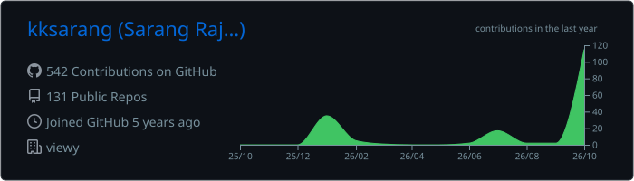
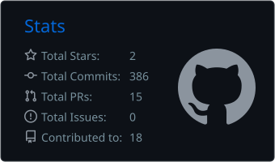
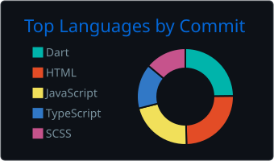
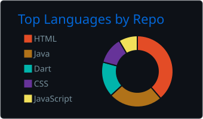
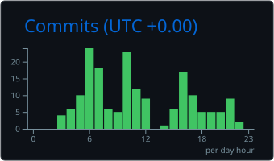

<div align="center">


<a href="https://git.io/typing-svg"></a>

<p>
<a href="https://sarangrajan.in/"></a>
<a href="https://www.linkedin.com/in/sarang-rajan"></a>
<a href="mailto:sarangrajan17@gmail.com"></a>
<a href="https://infoparkdaily.online/"></a>
</p>


</div>

---

## 👨‍💻 About Me

<table>
<tr>
<td width="58%" valign="top">

I'm a **mobile engineering lead** who ships apps end to end — from architecture and sprint planning to Play Store & App Store release.

- 🚀 **Application Development Team Lead & Project Head** at **Viewy Digital**, Kochi
- 👥 Lead cross-functional teams with **Agile** and own the full **product lifecycle**
- 📱 Native **Android (Kotlin/Java)** & **iOS (Swift)** + cross-platform **Flutter** & **React Native**
- 🌐 Founder of **[InfoparkDaily](https://infoparkdaily.online/)** — Kerala's largest tech & business community
- 🏗️ Founder of **Enitexa.ai** — mobile apps, websites & digital product studio
- 🎓 B.Tech Computer Science — College of Engineering, Thalassery
- 💬 Ask me about **Flutter, Android, team leadership, or growing a tech community**

</td>
<td width="42%" valign="top">

```kotlin
object Sarang {
    val role = "Team Lead | Project Head"
    val base = "Kerala, India 🇮🇳"
    val stack = listOf(
        "Flutter", "Kotlin", "Swift",
        "Java", "Dart", "React Native"
    )
    val experience = "6+ years"
    val founderOf = listOf(
        "InfoparkDaily", "Enitexa.ai"
    )
    fun motto() =
        "Ship fast. Scale clean. 🚀"
}
```

</td>
</tr>
</table>

---

## 🛠️ Tech Stack

<div align="center">

**Mobile**


**Web & Backend**


**Tools & Workflow**


</div>

---

## 🌐 InfoparkDaily — Kerala's Largest Tech Community

<div align="center">

<table>
<tr>
<td align="center" width="25%"><h2>68K+</h2><sub>Instagram Followers</sub></td>
<td align="center" width="25%"><h2>120M+</h2><sub>Social Reach</sub></td>
<td align="center" width="25%"><h2>1 Cr+</h2><sub>Monthly Views</sub></td>
<td align="center" width="25%"><h2>1,000+</h2><sub>Partner Companies</sub></td>
</tr>
</table>

Daily **Infopark Kochi jobs, walk-ins, tech news & brand campaigns** — connecting professionals, startups, recruiters and local businesses across Kakkanad & Kochi.

<a href="https://infoparkdaily.online/"></a>
<a href="https://www.instagram.com/infoparkdaily/"></a>
<a href="https://www.instagram.com/infoparkdaily.jobs/"></a>
<a href="https://whatsapp.com/channel/0029VbDJFfA4Y9lm5L4kpm22"></a>

</div>

---

## 💼 Experience

<details open>
<summary><b>🏢 Viewy Digital Pvt. Ltd</b> &nbsp;·&nbsp; Kochi &nbsp;·&nbsp; <i>Sep 2022 – Present (4+ yrs)</i></summary>
<br>

**🔹 Application Development Team Lead | Project Head** — *Oct 2023 – Present*
- Oversee **end-to-end mobile app delivery** from requirements to store release
- Lead and mentor a **cross-functional team** of developers, designers and QA using Agile/Scrum
- Own sprint planning, estimation, code reviews, architecture decisions and client communication

**🔹 Mobile Application Developer** — *Mar 2023 – Oct 2023*
- Built and shipped cross-platform and native mobile apps for client projects

**🔹 Flutter Developer** — *Sep 2022 – Mar 2023*
- Developed production Flutter apps with REST API integrations and pixel-perfect UI

</details>

<details>
<summary><b>🏢 VAAS Intelligent Technology Services</b> &nbsp;·&nbsp; Assistant Software Engineer &nbsp;·&nbsp; <i>Feb 2022 – Sep 2022</i></summary>
<br>

- Contributed to mobile and software projects across the full development cycle
- API integrations, feature development and production bug fixing

</details>

<details>
<summary><b>🏢 Svaro Wellness | Ayurveda</b> &nbsp;·&nbsp; Native Android Developer &nbsp;·&nbsp; <i>Jan 2021 – Feb 2022</i></summary>
<br>

- Native Android development in **Java and Kotlin**
- Managed and maintained the company **WordPress website**

</details>

<details>
<summary><b>🏢 Zoople Technologies</b> &nbsp;·&nbsp; Native Android Development Trainee &nbsp;·&nbsp; <i>Aug 2020 – Dec 2020</i></summary>
<br>

- Hands-on training in native Android, building real-world apps

</details>

---

## 📜 Certifications


---

## 📊 GitHub Dashboard

<div align="center">










</div>

<br>

<div align="center">

<picture>
  <source media="(prefers-color-scheme: dark)" srcset="https://raw.githubusercontent.com/kksarang/kksarang/output/github-snake-dark.svg"/>
  <source media="(prefers-color-scheme: light)" srcset="https://raw.githubusercontent.com/kksarang/kksarang/output/github-snake.svg"/>
  
</picture>

</div>

---

## 🤝 Let's Connect

<div align="center">

Open to **collaborations, startup ideas, mobile app projects and community partnerships**.

<a href="https://sarangrajan.in/"></a>
<a href="https://www.linkedin.com/in/sarang-rajan"></a>
<a href="mailto:sarangrajan17@gmail.com"></a>
<a href="https://infoparkdaily.online/"></a>


</div>
