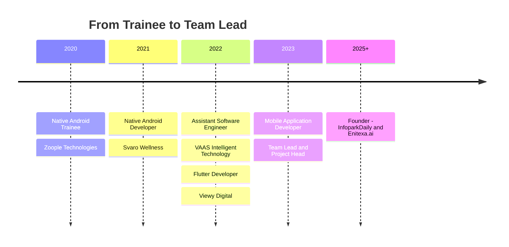
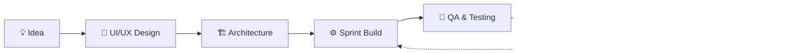

<a id="top"></a>
<div align="center">


<a href="https://git.io/typing-svg"></a>

<p>
<a href="https://sarangrajan.in/"></a>
<a href="https://www.linkedin.com/in/sarang-rajan"></a>
<a href="mailto:sarangrajan17@gmail.com"></a>
<a href="https://infoparkdaily.online/"></a>
</p>

<p>


</p>

</div>

---

## ⚡ At a Glance

<div align="center">

<table>
<tr>
<td align="center" width="20%"><h2>6+</h2><sub>Years in Mobile Dev</sub></td>
<td align="center" width="20%"><h2>4</h2><sub>Companies</sub></td>
<td align="center" width="20%"><h2>4</h2><sub>Platforms<br/>Android · iOS · Web · Cross</sub></td>
<td align="center" width="20%"><h2>68K+</h2><sub>Community Followers</sub></td>
<td align="center" width="20%"><h2>120M+</h2><sub>Social Reach</sub></td>
</tr>
</table>

</div>

---

## 👨‍💻 About Me

<table>
<tr>
<td width="58%" valign="top">

I'm a **mobile engineering lead** who ships apps end to end — from architecture and sprint planning to Play Store & App Store release. I also run one of Kerala's biggest tech communities.

- 🚀 **Application Development Team Lead & Project Head** at **Viewy Digital**, Kochi
- 👥 Lead cross-functional teams with **Agile** and own the full **product lifecycle**
- 📱 Native **Android (Kotlin/Java)** & **iOS (Swift)** + cross-platform **Flutter** & **React Native**
- 🌐 Founder of **[InfoparkDaily](https://infoparkdaily.online/)** — Kerala's largest tech & business community
- 🏗️ Founder of **Enitexa.ai** — mobile apps, websites & digital product studio
- 🎓 B.Tech Computer Science — College of Engineering, Thalassery

</td>
<td width="42%" valign="top">

```kotlin
object Sarang {
    val role = "Team Lead | Project Head"
    val base = "Kerala, India 🇮🇳"
    val stack = listOf(
        "Flutter", "Kotlin", "Swift",
        "Java", "Dart", "React Native"
    )
    val experience = "6+ years"
    val founderOf = listOf(
        "InfoparkDaily", "Enitexa.ai"
    )
    fun motto() =
        "Ship fast. Scale clean. 🚀"
}
```

</td>
</tr>
</table>

---

## 🔭 Right Now

<table>
<tr>
<td width="50%" valign="top">

**🛠️ Working on**
- Leading mobile delivery at **Viewy Digital**
- Growing **InfoparkDaily** — jobs, news & campaigns for Kerala IT
- Building client products at **Enitexa.ai**

</td>
<td width="50%" valign="top">

**🌱 Focused on**
- Scalable Flutter architecture for large apps
- Faster release pipelines for Android & iOS
- Helping Kerala techies find jobs and grow careers

</td>
</tr>
</table>

---

## 🛠️ Tech Stack

<div align="center">

**📱 Mobile**


**🌐 Web & Backend**


**🧰 Tools & Workflow**


</div>

<br/>

| Area | What I bring |
|---|---|
| 📱 **Cross-platform** | Flutter & React Native apps from a single codebase for Android and iOS |
| 🤖 **Native Android** | Kotlin & Java apps built with Android Studio |
| 🍎 **Native iOS** | Swift apps built with Xcode, App Store releases |
| 🧭 **Leadership** | Team management, sprint planning, code reviews, client communication |
| 🔄 **Delivery** | Agile execution and end-to-end product lifecycle ownership |
| 📣 **Growth** | Community building, reels-first content and digital campaigns |

---

## 🚀 Featured Ventures

<table>
<tr>
<td width="33%" valign="top" align="center">

### 🌐 InfoparkDaily
Kerala's largest tech & business community around Infopark Kochi — daily jobs, walk-ins, tech news and brand campaigns.

<a href="https://infoparkdaily.online/"></a>

</td>
<td width="33%" valign="top" align="center">

### 🏗️ Enitexa.ai
A studio for mobile apps, websites and digital products — from idea to launch for startups and businesses.

<a href="https://infoparkdaily.online/software-solutions/"></a>

</td>
<td width="33%" valign="top" align="center">

### 👤 Portfolio
My personal site with the apps, platforms and digital products I've built and led.

<a href="https://sarangrajan.in/"></a>

</td>
</tr>
</table>

---

## 🌐 InfoparkDaily in Numbers

<div align="center">

<table>
<tr>
<td align="center" width="25%"><h2>68K+</h2><sub>Instagram Followers</sub></td>
<td align="center" width="25%"><h2>120M+</h2><sub>Social Reach</sub></td>
<td align="center" width="25%"><h2>1 Cr+</h2><sub>Monthly Views</sub></td>
<td align="center" width="25%"><h2>1,000+</h2><sub>Partner Companies</sub></td>
</tr>
</table>

<a href="https://www.instagram.com/infoparkdaily/"></a>
<a href="https://www.instagram.com/infoparkdaily.jobs/"></a>
<a href="https://www.instagram.com/infoparkdaily.media/"></a>
<a href="https://whatsapp.com/channel/0029VbDJFfA4Y9lm5L4kpm22"></a>

</div>

---

## 🗺️ Career Journey



<details>
<summary><b>💼 Full experience details</b> (click to expand)</summary>
<br>

**🏢 Viewy Digital Pvt. Ltd** — Kochi · *Sep 2022 – Present*

- **Application Development Team Lead | Project Head** · *Oct 2023 – Present*
  - Oversee end-to-end mobile app delivery from requirements to store release
  - Lead a cross-functional team of developers, designers and QA using Agile/Scrum
  - Own sprint planning, estimation, code reviews, architecture and client communication
- **Mobile Application Developer** · *Mar 2023 – Oct 2023* — built and shipped cross-platform and native apps
- **Flutter Developer** · *Sep 2022 – Mar 2023* — production Flutter apps with REST APIs and pixel-perfect UI

**🏢 VAAS Intelligent Technology Services** — Assistant Software Engineer · *Feb 2022 – Sep 2022*
- Full-cycle development, API integrations, feature work and production bug fixing

**🏢 Svaro Wellness | Ayurveda** — Native Android Developer · *Jan 2021 – Feb 2022*
- Native Android apps in Java and Kotlin; managed the company WordPress website

**🏢 Zoople Technologies** — Native Android Development Trainee · *Aug 2020 – Dec 2020*
- Hands-on native Android training building real-world apps

</details>

---

## 🔄 How I Ship Apps



---

## 📜 Certifications


---

## 📊 GitHub Dashboard

<div align="center">


</div>

<br>

<div align="center">

<picture>
  <source media="(prefers-color-scheme: dark)" srcset="https://raw.githubusercontent.com/kksarang/kksarang/output/github-snake-dark.svg"/>
  <source media="(prefers-color-scheme: light)" srcset="https://raw.githubusercontent.com/kksarang/kksarang/output/github-snake.svg"/>
  
</picture>

</div>

---

## 🎯 Fun Facts

<details>
<summary><b>Click to reveal 🎲</b></summary>
<br>

- 🧬 Studied **Biology** in higher secondary, then switched to **Computer Science**
- 🤖 Started as an Android trainee in 2020 and became a Team Lead in about 3 years
- 📣 Grew a tech community to **68K+ followers** and **120M+ reach** alongside a full-time role
- 🌏 Built apps across Kerala and Karnataka
- ☕ Fuelled by Kerala chai and clean architecture

</details>

---

## 🤝 Let's Build Something

<div align="center">

> 💬 *"Great products come from great teams. Let's build one together."*

Open to **collaborations, startup ideas, mobile app projects, hiring campaigns and community partnerships**.

<a href="https://sarangrajan.in/"></a>
<a href="https://www.linkedin.com/in/sarang-rajan"></a>
<a href="mailto:sarangrajan17@gmail.com"></a>
<a href="https://www.instagram.com/infoparkdaily/"></a>
<a href="https://whatsapp.com/channel/0029VbDJFfA4Y9lm5L4kpm22"></a>

<br/><br/>

⭐ *If you like my work, star a repo — it keeps me motivated!*

<a href="#top">⬆️ Back to top</a>


</div>
